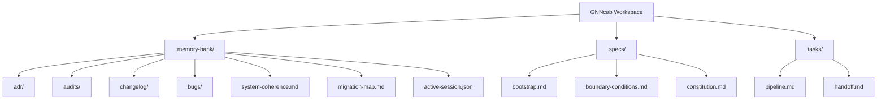

# Memory Bank Structure

This directory holds the active context, architectural records, audits, and task tracking for the `GNNcab` monorepo. It ensures that humans and AI agents can synchronize and preserve alignment across workspace sessions.

## File & Directory Structure

### 1. `.memory-bank/`
Holds the core project memory index, long-term decisions, and historical logs.
- **`adr/`**: Architecture Decision Records (ADRs). Documents architectural decisions and patterns (e.g., unit conversions, backend boundaries, security policies).
- **`audits/`**: Safety, compliance, and security inspection audit results (e.g., LocalStorage JWT mitigations, deep security audit report).
- **`changelog/`**: Tracks verified work logs, milestones, and historical release notes (`verified-worklog.md`).
- **`bugs/`**: Ongoing tracking of known bugs, risks, and verification statuses (`bug-list.md`).
- **`system-coherence.md`**: Guide outlining operating principles, change checks, and alignment protocols.
- **`migration-map.md`**: Maps legacy `agents/` files to the restructured directory hierarchy.
- **`active-session.json`**: Current active session context and sprint tracking.

### 2. `.tasks/`
Tracks day-to-day work, active checklists, and progress.
- **`pipeline.md`**: Active sprint, immediate next steps, backlog, and suggested validation plans.
- **`handoff.md`**: Transition instructions and status summary between coding sessions.

### 3. `.specs/`
Documents static rules, constitutions, and system specs.
- **`bootstrap.md`**: Development setup, repository components, local commands, and runtime dependencies.
- **`boundary-conditions.md`**: Secure boundaries, limits, distance configurations, and API restrictions.
- **`constitution.md`**: Standard coding constitution for code style and AI agent limits.

---

## Architectural Decision Records (ADRs)

| ADR | Title | Status |
|---|---|---|
| [ADR 0001](file:///c:/Users/bigde/.antigravity/GNNcab/.memory-bank/adr/0001-preserve-backend-first-monorepo.md) | Preserve Backend-First Monorepo | Accepted |
| [ADR 0002](file:///c:/Users/bigde/.antigravity/GNNcab/.memory-bank/adr/0002-single-worker-until-redis-realtime.md) | Single Worker Until Redis Realtime | Accepted |
| [ADR 0003](file:///c:/Users/bigde/.antigravity/GNNcab/.memory-bank/adr/0003-production-routing-fails-closed-to-osrm.md) | Production Routing Fails Closed to OSRM | Accepted |
| [ADR 0004](file:///c:/Users/bigde/.antigravity/GNNcab/.memory-bank/adr/0004-browser-origin-and-websocket-token-boundaries.md) | Browser Origin & WS Token Boundaries | Accepted |
| [ADR 0005](file:///c:/Users/bigde/.antigravity/GNNcab/.memory-bank/adr/0005-backup-gated-database-deployment.md) | Backup Gated Database Deployment | Accepted |
| [ADR 0006](file:///c:/Users/bigde/.antigravity/GNNcab/.memory-bank/adr/0006-candidate-public-deployment-topology.md) | Candidate Public Deployment Topology | Accepted |
| [ADR 0007](file:///c:/Users/bigde/.antigravity/GNNcab/.memory-bank/adr/0007-mobile-app-strategy-flutter.md) | Mobile App Strategy (Flutter) | Accepted |
| [ADR 0008](file:///c:/Users/bigde/.antigravity/GNNcab/.memory-bank/adr/0008-us-distance-units-use-miles.md) | Use Miles for US Distance Units | Accepted |
| [ADR 0009](file:///c:/Users/bigde/.antigravity/GNNcab/.memory-bank/adr/0009-dependency-security-vulnerability-remediation.md) | Dependency Security Vulnerability Remediation | Accepted |
